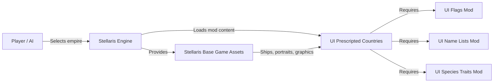
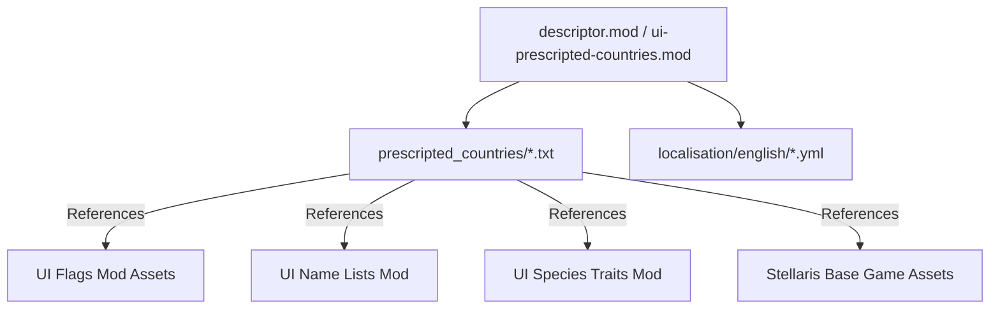
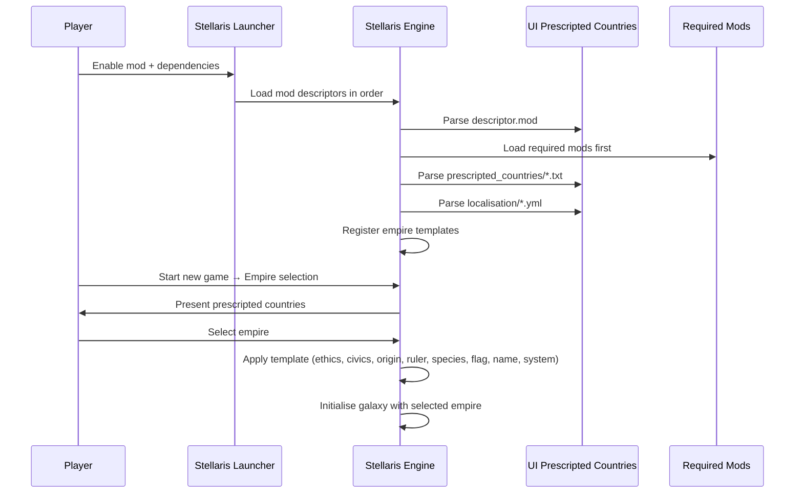
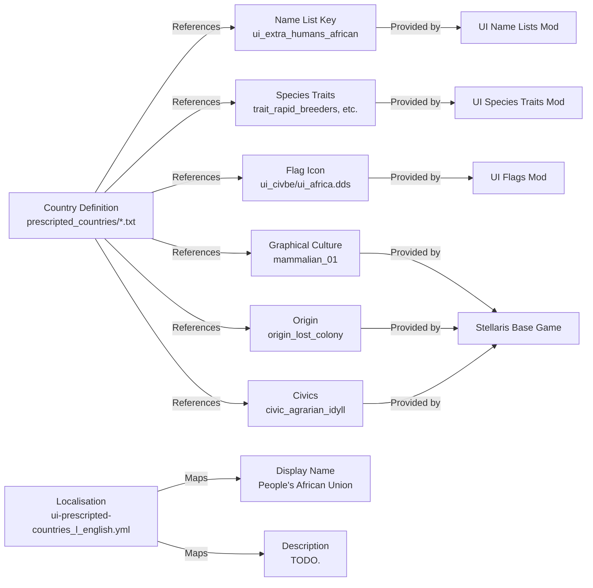
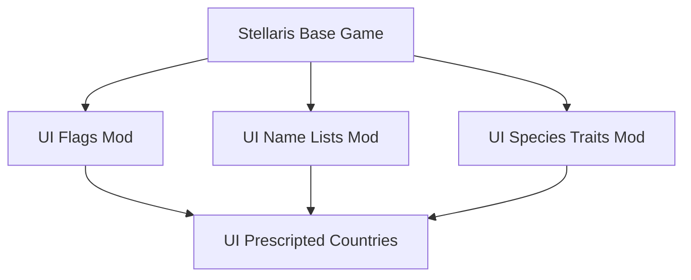

# Universum Infinitum: Prescripted Countries Architecture

This document describes the current architecture of the Universum Infinitum: Prescripted Countries mod for Stellaris. It covers the mod structure, content organisation, integration boundaries, and deployment model.

## 📑 Table of Contents

- [Purpose](#-purpose)
- [System Context](#-system-context)
- [Architectural Style](#-architectural-style)
- [Runtime Flow](#-runtime-flow)
- [Architectural Areas](#-architectural-areas)
- [Data Architecture](#-data-architecture)
- [Interfaces and Integrations](#-interfaces-and-integrations)
- [Dependency Direction and Rules](#-dependency-direction-and-rules)
- [External Dependencies](#-external-dependencies)
- [Deployment and Operations](#-deployment-and-operations)
- [Compatibility Contracts](#-compatibility-contracts)
- [Testing and Verification](#-testing-and-verification)
- [Design Constraints](#-design-constraints)
- [Related Documentation](#-related-documentation)

## 🎯 Purpose

This mod adds prescripted countries (pre-defined empires) for Stellaris that players or AI can select when starting a new game. The architecture documents how country definitions, localisation, and graphical assets are organised, how they integrate with the Stellaris game engine, and the dependency requirements for the Universum Infinitum collection.

## 🌐 System Context

The mod is a content-only Stellaris mod with no executable code. It defines empire templates that the game loads during galaxy generation and empire selection.



The principal external boundaries are:
- **Stellaris Game Engine:** Loads mod descriptors, parses country definitions, renders UI, and applies empire templates during game start. Owned by Paradox Interactive.
- **UI Flags Mod:** Supplies custom flag icons and backgrounds referenced by country definitions. Owned by this collection.
- **UI Name Lists Mod:** Provides name lists (ship names, planet names, ruler names) referenced by country definitions. Owned by this collection.
- **UI Species Traits Mod:** Supplies custom species traits referenced by country definitions. Owned by this collection.
- **Steam Workshop / Paradox Mods / Nexus Mods / GitHub Releases:** Distribution channels for the packaged mod. No runtime integration.

## 🏗️ Architectural Style

**Data-driven content pack** — The mod consists entirely of declarative data files consumed by the Stellaris script parser. There is no runtime logic, no code compilation, and no process boundary. The architecture is defined by:

- **File-based composition:** Each prescripted country is a self-contained `.txt` file in `prescripted_countries/`.
- **Shared localisation:** All display strings reside in a single YAML file per language.
- **Asset references:** Country definitions reference graphical assets (flags, portraits, graphical cultures) by identifier; the actual assets are provided by the UI Flags mod and the base game.
- **Dependency declaration:** The `.mod` descriptor lists required mods; the game enforces load order and missing-dependency errors.



The principal architecture boundaries are:
- **Mod Descriptor:** Declares version, supported game version, tags, and required dependencies. Single source of truth for load metadata.
- **Country Definitions:** Each file defines one empire template (ethics, civics, origin, ruler, species, flag, graphical culture, spawn settings).
- **Localisation:** Maps internal keys to display strings for empire names, descriptions, and UI text.

## 🔄 Runtime Flow



The principal runtime sequence is:
1. **Launcher load:** Player enables the mod and its three required dependencies in the Stellaris launcher.
2. **Descriptor parsing:** Engine reads `descriptor.mod` (or `ui-prescripted-countries.mod`), validates `supported_version`, and loads required mods first.
3. **Country registration:** Engine parses each `.txt` in `prescripted_countries/`, registers empire templates in the internal empire database.
4. **Localisation registration:** Engine loads `ui-prescripted-countries_l_english.yml` (and other languages if present) for display strings.
5. **Game start:** Player selects a prescripted country in the empire selection screen; engine applies the full template at galaxy initialisation.

## 🗂️ Architectural Areas

### Mod Descriptor

Paths:
- `ui-prescripted-countries.mod` (repository root, for manual install)
- `ui-prescripted-countries/descriptor.mod` (inside mod folder, for workshop/Paradox Mods)

Responsibilities:
- Declares mod identity, version, supported game version (`3.9.*`), and tags.
- Lists required dependencies: UI Flags, UI Name Lists, UI Species Traits.
- Provides filesystem path for the mod content.

Boundary rules:
- Must remain synchronised between the two descriptor files.
- `supported_version` must be updated for each major Stellaris release.
- Dependency IDs must match the published workshop/Paradox Mods IDs.

### Country Definitions

Paths:
- `ui-prescripted-countries/prescripted_countries/*.txt` (24 files)

Responsibilities:
- Each file defines one complete empire template using Stellaris country definition syntax.
- Specifies: key, species, name, adjective, authority, government, planet, system, graphical culture, flag, ruler, ethics, civics, origin, spawn settings.

Boundary rules:
- File naming convention: `ui_<source>_<name>.txt` (e.g., `ui_civbe_africa.txt`, `ui_elderscrolls_aldmeri.txt`).
- All referenced name lists, traits, flag icons, and graphical cultures must exist in dependencies or base game.
- `ignore_portrait_duplication=yes` permits multiple countries to share the same portrait.
- `spawn_enabled=yes` makes the country available for AI and player selection.

### Localisation

Paths:
- `ui-prescripted-countries/localisation/english/ui-prescripted-countries_l_english.yml`

Responsibilities:
- Provides display strings for empire design names and descriptions.
- Keys follow pattern `EMPIRE_DESIGN_<country_key>` and `EMPIRE_DESIGN_<country_key>_desc`.
- Uses `l_english:` root key per Stellaris localisation format.

Boundary rules:
- One file per supported language (currently only English).
- Must cover every empire design key referenced in country definitions.
- Descriptions marked `TODO.` indicate incomplete content.

## 💾 Data Architecture



| Data or Store | Owner | Representation and Storage | Lifecycle or Consistency |
|---------------|-------|----------------------------|--------------------------|
| `Country Definition` | Mod (this repo) | Stellaris script format (Clausewitz script), UTF-8 `.txt` | Static at mod load; parsed once per game session |
| `Localisation Strings` | Mod (this repo) | YAML with `l_english:` root, UTF-8 `.yml` | Static at mod load; merged into game localisation database |
| `Name Lists` | UI Name Lists Mod | Stellaris name list format, `.txt` | Loaded by dependency; referenced by key |
| `Species Traits` | UI Species Traits Mod | Stellaris trait format, `.txt` | Loaded by dependency; referenced by key |
| `Flag Icons / Backgrounds` | UI Flags Mod | DDS textures, referenced by category/file | Loaded by dependency; referenced by category/file |
| `Graphical Cultures` | Stellaris Base Game | Internal engine assets | Referenced by identifier (`mammalian_01`, etc.) |
| `Origins, Civics, Authorities, Governments` | Stellaris Base Game | Internal game database | Referenced by key (`origin_lost_colony`, `civic_agrarian_idyll`, etc.) |

## 🔌 Interfaces and Integrations

| Interface or Integration | Direction | Contract | Owner | Failure Semantics |
|--------------------------|-----------|----------|-------|-------------------|
| `descriptor.mod` | Outbound (to engine) | Stellaris mod descriptor format v1 | This mod | Missing/incorrect → mod fails to load; launcher shows error |
| `prescripted_countries/*.txt` | Outbound (to engine) | Stellaris country definition syntax | This mod | Syntax error → empire not registered; log warning |
| `localisation/*.yml` | Outbound (to engine) | Stellaris localisation YAML format | This mod | Missing key → displays raw key in UI |
| UI Flags Mod | Inbound (dependency) | Provides `ui_civbe/*` flag icons and `backgrounds/*` | UI Flags Mod | Missing → flag renders as placeholder; no crash |
| UI Name Lists Mod | Inbound (dependency) | Provides `ui_extra_humans_*`, `ui_civbe_*`, `ui_elderscrolls_*`, `ui_galciv_*`, `ui_starcraft_*` name lists | UI Name Lists Mod | Missing → names fall back to base game defaults |
| UI Species Traits Mod | Inbound (dependency) | Provides custom traits referenced by countries | UI Species Traits Mod | Missing → trait validation fails; empire may not spawn |
| Stellaris Base Game | Inbound (platform) | Provides base graphical cultures, origins, civics, authorities, governments, portraits | Paradox Interactive | Version mismatch → `supported_version` gate blocks load |

## 🧭 Dependency Direction and Rules



The principal dependency rules are:
- **Permitted:** This mod depends on UI Flags, UI Name Lists, UI Species Traits, and Stellaris base game.
- **Permitted:** UI Flags, UI Name Lists, UI Species Traits depend only on Stellaris base game.
- **Prohibited:** This mod must not depend on any other mods.
- **Prohibited:** Circular dependencies between Universum Infinitum mods.
- **Ownership:** Each Universum Infinitum mod owns its content area; cross-references are by stable key only.

## 📦 External Dependencies

| Dependency | Responsibility | Integration Boundary | Architectural Consequence |
|------------|----------------|----------------------|---------------------------|
| `Stellaris Base Game (v3.9.*)` | Engine, base assets, script parser, localisation system, empire template application | Mod descriptor `supported_version`, script API, asset identifiers | Version gate; breaking changes in 3.10+ may require updates |
| `UI Flags Mod` (Workshop 2048949836) | Custom flag icons (`ui_civbe/*`, `ui_elderscrolls/*`, `ui_galciv/*`, `ui_starcraft/*`) and backgrounds | Referenced by `empire_flag.icon.category/file` and `empire_flag.background.category/file` in country definitions | Missing mod → flags render as generic placeholders |
| `UI Name Lists Mod` (Workshop 2048949838) | Name lists for ships, planets, rulers, fleets (`ui_extra_humans_*`, `ui_civbe_*`, `ui_elderscrolls_*`, `ui_galciv_*`, `ui_starcraft_*`) | Referenced by `species.name_list` in country definitions | Missing mod → names fall back to base game defaults |
| `UI Species Traits Mod` (Workshop 2048949839) | Custom species traits referenced by countries | Referenced by `species.trait` in country definitions | Missing mod → trait validation fails; empire may not spawn |

## 🚀 Deployment and Operations

| Concern | Current Design | Architectural Consequence |
|---------|----------------|---------------------------|
| **Process topology** | Content-only mod; no separate process. Loaded by Stellaris engine at startup. | Zero operational overhead; no background services. |
| **Deployment unit** | Two distribution formats: (1) Steam Workshop / Paradox Mods (auto-updating), (2) GitHub Release ZIP (manual install), (3) Nexus Mods. | Users choose channel; content identical across channels. |
| **Persistent state** | None. Mod is read-only data. Game saves store instantiated empire data, not mod files. | No migration needed for mod updates; existing saves unaffected. |
| **Filesystem requirements** | Mod folder placed in Stellaris mod directory (`~/Paradox Interactive/Stellaris/mod/` on Linux). | Standard mod installation; no special permissions. |
| **Scaling assumptions** | Single-player / multiplayer host loads mod once. No scaling concerns. | Trivial. |
| **Startup responsibilities** | Launcher validates dependencies and load order; engine parses descriptors and scripts. | Missing dependency → launcher blocks enable; parse error → log warning, empire omitted. |
| **Shutdown responsibilities** | None. Engine unloads mod data on exit. | Trivial. |
| **Operator-visible outputs** | Launcher mod list, empire selection screen, in-game empire tooltips, flag display. | Content quality directly visible to players. |

## 🛡️ Compatibility Contracts

| Contract | Owner | Invariant | Verification | Change Policy |
|----------|-------|-----------|--------------|---------------|
| `supported_version` in descriptor | This mod | Must match current Stellaris major.minor (e.g., `3.9.*`) | Launcher validation; CI can check against known versions | Update on each Stellaris major release; patch versions wildcarded |
| Country definition keys | This mod | Unique `key` per country; stable across versions | Engine rejects duplicates at load | Never rename keys; add new countries only |
| Name list keys | UI Name Lists Mod | Keys referenced by `species.name_list` must exist | Engine logs missing name list warning | Coordinate with Name Lists mod for new keys |
| Trait keys | UI Species Traits Mod | Keys referenced by `species.trait` must exist | Engine validates at empire creation | Coordinate with Species Traits mod for new traits |
| Flag icon paths | UI Flags Mod | `category`/`file` pairs must exist in Flags mod | Visual inspection in empire selection | Coordinate with Flags mod for new icons |
| Localisation keys | This mod | `EMPIRE_DESIGN_<key>` and `EMPIRE_DESIGN_<key>_desc` for each country | In-game UI shows raw key if missing | Add localisation for every new country; update on text changes |

## ✅ Testing and Verification

No automated test suite exists. Verification is manual and integration-based:

1. **Launcher validation:** Enable mod + three dependencies in Stellaris launcher; verify no missing-dependency errors.
2. **Load verification:** Start game; open empire selection; confirm all 24 prescripted countries appear.
3. **Visual verification:** Select each country; verify flag, portrait, name, adjective, ruler portrait, planet, system, ethics, civics, origin display correctly.
4. **Gameplay verification:** Start a game with a prescripted country; verify spawn, ethics, civics, origin effects apply.
5. **Cross-platform verification:** Test on Linux (native and Steam Play); Windows and macOS assumed compatible by file-format portability.

Execute the principal automated verification with:

```bash
# No automated verification commands exist.
# Manual verification steps:
# 1. Install Stellaris (v3.9.x)
# 2. Subscribe to required mods on Steam Workshop (or install manually)
# 3. Enable all four mods in launcher
# 4. Launch game → New Game → Empire Selection
# 5. Verify all 24 countries listed and selectable
```

Material coverage gaps:
- No automated syntax validation for `.txt` country definitions.
- No localisation completeness check (descriptions marked `TODO.`).
- No CI pipeline for descriptor version compatibility.

## ⚠️ Design Constraints

- **Stellaris script format:** Country definitions must use Clausewitz script syntax; no alternative formats supported.
- **Game version coupling:** `supported_version` in descriptor ties mod to specific Stellaris major.minor; updates required for each major release.
- **Dependency coupling:** Three hard required mods; any breaking change in those mods requires coordinated updates.
- **No executable code:** Cannot add custom logic, events, or mechanics beyond what country definition syntax expresses.
- **Asset references by string:** Flag icons, name lists, traits referenced by opaque keys; no compile-time validation.
- **Single-language localisation:** Only English provided; other languages show raw keys.
- **Incomplete descriptions:** Many empire descriptions are `TODO.`; content completeness is ongoing.
- **Portrait duplication:** Multiple countries share base game portraits; `ignore_portrait_duplication=yes` mitigates but limits visual distinctiveness.

## 📚 Related Documentation

- [README.md](./README.md) — Project overview, installation, compatibility, contribution guidelines.
- [CONTRIBUTING.md](./CONTRIBUTING.md) — Issue reporting, pull request process, code style.
- [SECURITY.md](./SECURITY.md) — Coordinated disclosure policy, security scope for content-only mod.
- [CODE_OF_CONDUCT.md](./CODE_OF_CONDUCT.md) — Community standards.
- [PRIVACY.md](./PRIVACY.md) — Data handling (none collected).
- [UI Flags Mod](https://github.com/hmlendea/stellaris-ui-flags) — Flag icons and backgrounds dependency.
- [UI Name Lists Mod](https://github.com/hmlendea/stellaris-ui-name-lists) — Name lists dependency.
- [UI Species Traits Mod](https://github.com/hmlendea/stellaris-ui-species-traits) — Species traits dependency.