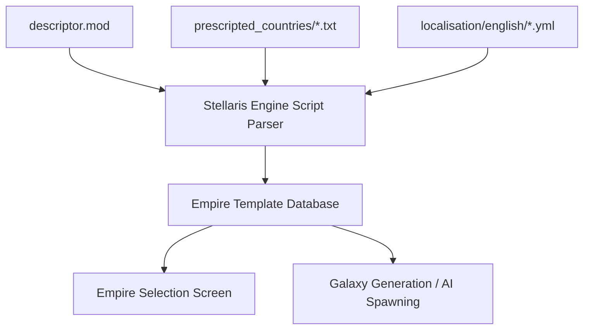

# Architecture

This document complements the root [ARCHITECTURE.md](../ARCHITECTURE.md), which owns the canonical system context, runtime flow, dependency rules, and compatibility contracts. Read that document first. This file expands on areas that future agents most frequently need when modifying this repository.

## Architectural Summary

The mod is a data-driven content pack. The Stellaris engine is the only consumer of every file in the mod folder. There is no code, no build, and no runtime logic owned by this repository.

## Architectural Areas

### Mod descriptor

Paths:
- `ui-prescripted-countries.mod`
- `ui-prescripted-countries/descriptor.mod`

The descriptor is the load-time contract with the engine. It declares `version`, `name`, `path`, `tags`, and `supported_version`. The engine validates `supported_version` (`3.9.*`) against the installed game and rejects the mod on mismatch.

Boundary rules:
- The two descriptor files must carry identical content.
- Bump `version` with every content change.
- Update `supported_version` for each Stellaris major/minor release.

### Country definitions

Path: `ui-prescripted-countries/prescripted_countries/`

Each file defines exactly one empire template in Clausewitz script. The top-level block name and the `key` field must match (for example `"People's African Union"={ key="People's African Union" ... }`). The engine registers templates by key; duplicate keys cause load failures or silent omission.

Every definition is self-contained: no country file references another country file. All cross-mod references are by opaque string keys resolved against dependencies at load time.

### Localisation

Path: `ui-prescripted-countries/localisation/english/`

The single YAML file maps localisation keys to display strings under the mandatory `l_english:` root. Country definitions that use non-literal names (those without `literal=yes`) resolve through `EMPIRE_DESIGN_<key>` keys.

## Data Flow Boundaries

Information crosses three boundaries at load time:

1. **Descriptor → engine launcher:** version gate, load order, dependency resolution.
2. **Script → engine parser:** country definitions become internal empire template objects. Parse errors produce log warnings and omit the empire; they do not abort the game.
3. **Localisation → engine text system:** keys merge into the global localisation database. Missing keys render as raw key text in the UI.

At galaxy-generation time, a fourth boundary applies: the engine resolves referenced keys (name lists, traits, flag icon paths, graphical cultures, origins, civics, authorities) against the loaded mod database. Unresolvable references degrade the template — missing name lists fall back to defaults; missing traits can prevent the empire from spawning.

## Invariants

- Every country `key` is unique across the mod and stable across versions.
- Every referenced name list key exists in Universum Infinitum - Name Lists.
- Every referenced trait key exists in Universum Infinitum - Species Traits or the base game.
- Every referenced flag icon `category`/`file` pair exists in Universum Infinitum - Flags or the base game.
- Localisation covers every `EMPIRE_DESIGN_*` key referenced by country definitions that require it.

## Related Documentation

- Root [ARCHITECTURE.md](../ARCHITECTURE.md) — canonical architecture.
- [Data model](./data-model.md) — country definition field semantics.
- [Dependencies](./dependencies.md) — companion mod contracts.
- [Change guide](./change-guide.md) — safe modification procedures.
