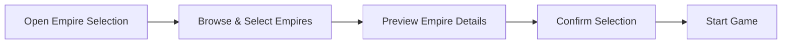

# Behaviour

This directory documents user-facing behaviours and interactions.

## Behaviour Index

| Behaviour | Path | Description |
|-----------|------|-------------|
| [Browse & select empires](./behaviour/browse-and-select-empires.md) | Empire selection screen interaction | Player browses, filters, and selects from 26 mod empires |
| [Preview empire details](./behaviour/preview-empire-details.md) | Empire customization/preview | Player inspects ethics, civics, origin, species, flag before selection |

## Behaviour Flow

All behaviours are provided by the Stellaris base game UI. The mod only supplies data.