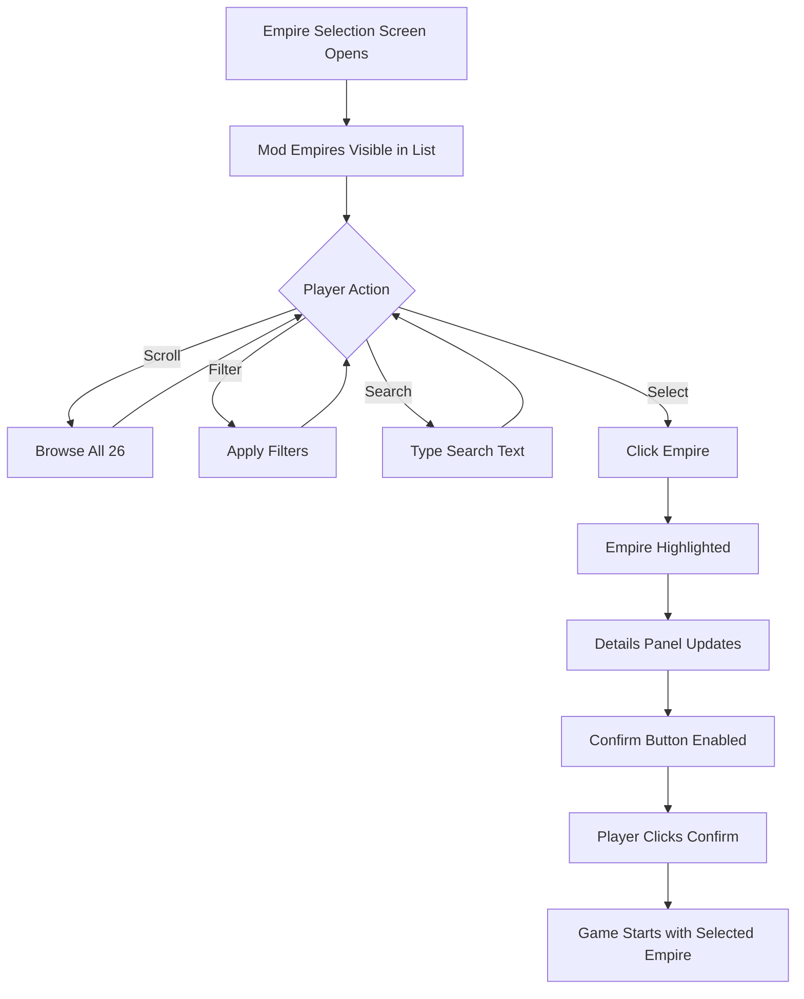

# Browse & Select Empires

## User Goal

Find and choose a prescripted empire to play from the 26 provided by this mod.

## Entry Point

Main Menu → New Game → Empire Selection

## Interaction Flow

## Filters Available

| Filter | Values | Mod Empire Coverage |
|--------|--------|---------------------|
| Authority | Democratic, Oligarchic, Dictatorial, Imperial, Corporate, Hive Mind, Machine Intelligence | All 6 non-gestalt authorities represented |
| Ethics | Fanatic/Standard variants of 8 ethics | 14 fanatic, 12 standard across 26 empires |
| Origin | 15+ origins | 10 lost_colony, 6 default, 4 life_seeded, 3 shoulders_of_giants, others |
| Species Class | Mammalian, Reptilian, Avian, etc. | All HUM (humanoid) |

## Search Behaviour

- Matches against localised `name` and `adjective`.
- Case-insensitive substring match.
- Example: "roman" → Roman Empire; "dominion" → Aldmeri Dominion, Terran Dominion.

## Visual Indicators

| Indicator | Meaning |
|-----------|---------|
| Flag icon | From Universum Infinitum Flags dependency |
| Ethics icons | Fanatic = double icon; Standard = single icon |
| Civic icons | Two per empire |
| Origin icon | Origin-specific artwork |
| Portrait | Species portrait (human/humanoid variants) |

## Edge Cases

- **Missing dependency**: Flag shows placeholder; name list shows key; trait shows key.
- **Duplicate empire key**: Second mod with same key is ignored (load order dependent).
- **Localisation missing**: Raw key displayed (e.g., `EMPIRE_DESIGN_PEOPLES_AFRICAN_UNION`).

## Invariants

- All 26 empires appear in unfiltered list.
- Filtering never crashes the UI.
- Selection always enables confirm button.
- No mod-specific UI code exists — all behaviour is base game.

## Related Documentation

- [Preview empire details](./preview-empire-details.md)
- [Empire selection screen](../flows/empire-selection-screen.md)
- [Country definitions](../components/country-definitions.md)
- [Dependencies](../dependencies.md)