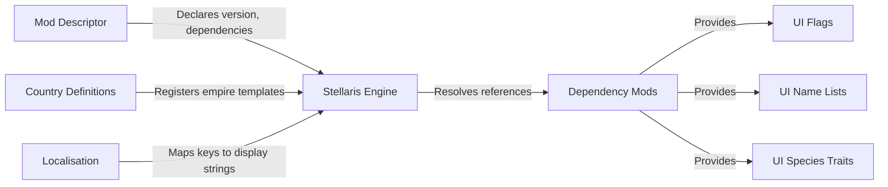

# Components

This directory contains deep-dive documentation for each architectural component of the mod.

## Component Index

| Component | Path | Responsibility |
|-----------|------|----------------|
| [Mod descriptor](./components/mod-descriptor.md) | `ui-prescripted-countries.mod`, `ui-prescripted-countries/descriptor.mod` | Load-time contract with Stellaris engine |
| [Country definitions](./components/country-definitions.md) | `ui-prescripted-countries/prescripted_countries/*.txt` | Empire template registration |
| [Localisation](./components/localisation.md) | `ui-prescripted-countries/localisation/english/*.yml` | Display string resolution |

## Cross-Component Relationships

Each component is a self-contained data file set consumed by the Stellaris engine. There is no code, no build pipeline, and no runtime interaction between components — the engine is the sole consumer and integrator.