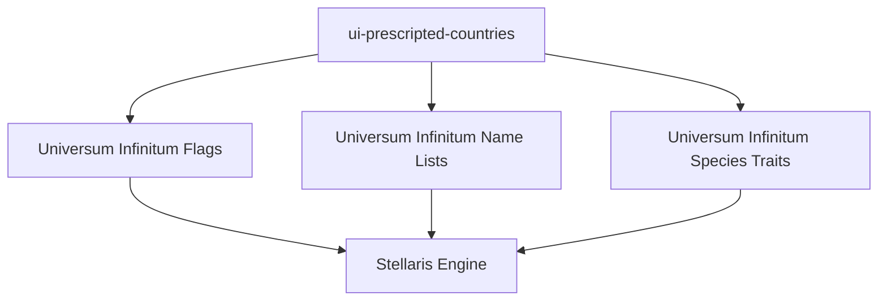

# Dependencies

## Required Mods

This mod requires three companion mods from the Universum Infinitum collection. All must be installed and enabled for correct operation.

| Mod | Workshop ID | Provides |
|-----|-------------|----------|
| Universum Infinitum Flags | 2048949836 | Custom flag textures (icon + background) for all 26 empires |
| Universum Infinitum Name Lists | 2048949838 | Custom name lists for ships, fleets, planets, leaders |
| Universum Infinitum Species Traits | 2048949839 | Custom species traits referenced by empire templates |

## Dependency Graph

## Load Order

Stellaris launcher enforces dependency load order automatically via workshop IDs. No manual ordering required.

## Cross-Mod References

### Flags

Each empire's `empire_flag` block references:
- `icon.category` + `icon.file` → flag icon texture
- `background.category` + `background.file` → flag background texture
- `colors` array → 4 color indices into flag palette

All textures provided by Universum Infinitum Flags.

### Name Lists

Countries reference name lists via:
- `ship_prefix.key` → name list key for ship prefixes
- `name.key` → name list key for empire name (when not literal)
- `adjective.key` → name list key for adjective
- `planet_name.key` → name list key for homeworld
- `system_name.key` → name list key for home system

All keys provided by Universum Infinitum Name Lists.

### Species Traits

Species blocks reference traits via:
- `species.traits` array → trait keys

All traits provided by Universum Infinitum Species Traits.

## Failure Modes

| Missing Dependency | Symptom |
|-------------------|---------|
| Flags | Flag shows placeholder texture; colors may not render |
| Name Lists | Empire name, ship prefix, planet/system names show raw keys |
| Species Traits | Species trait slots empty; empire may have no traits |

## Version Compatibility

All four mods (this + 3 dependencies) are versioned together. Update all simultaneously.

## Related Documentation

- [Mod descriptor](../components/mod-descriptor.md) — dependency declaration
- [Country definitions](../components/country-definitions.md) — reference usage
- [Change guide](../change-guide.md) — coordinated updates