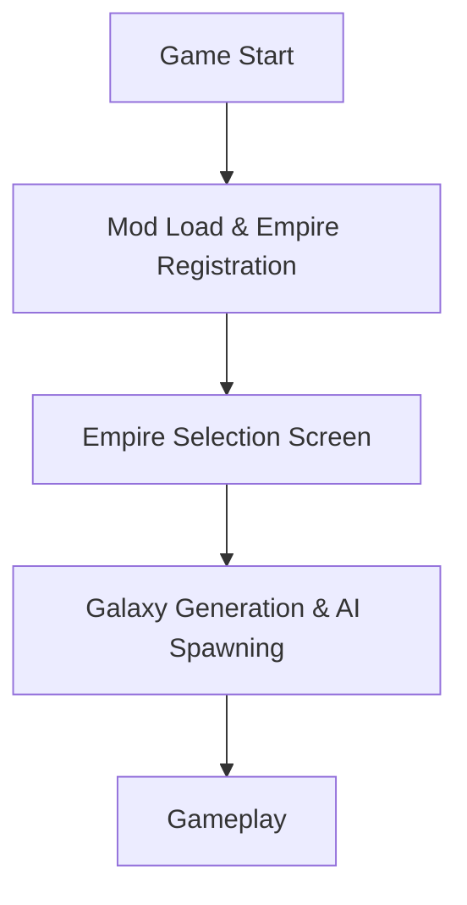

# Flows

This directory documents end-to-end execution flows from the Stellaris engine perspective.

## Flow Index

| Flow | Path | Trigger |
|------|------|---------|
| [Mod load & empire registration](./flows/mod-load-and-empire-registration.md) | Game startup / mod reload | Launcher validates → engine parses descriptors → registers empire templates |
| [Empire selection screen](./flows/empire-selection-screen.md) | Player opens empire selection | Engine presents registered templates → player chooses |
| [Galaxy generation & AI spawning](./flows/galaxy-generation-and-ai-spawning.md) | New game start | Engine spawns AI empires from registered templates |

## Flow Relationships

All flows are driven by the Stellaris engine. The mod provides static data only; it has no runtime logic.