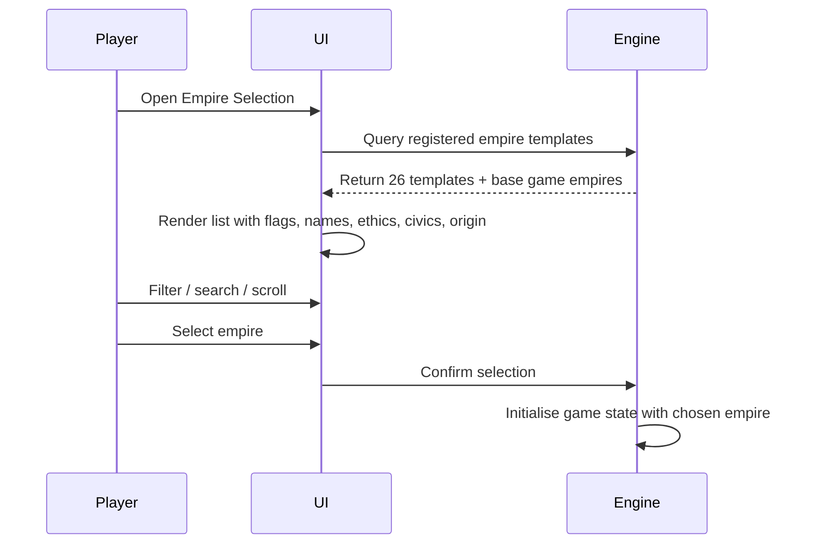

# Empire Selection Screen

## Trigger

Player opens "New Game" → "Empire Selection" in the Stellaris UI.

## Sequence

## UI Presentation

Each empire entry displays:

| UI Element | Source |
|------------|--------|
| Flag | `empire_flag` block (icon + background + colors) |
| Empire name | `name` key → localisation |
| Adjective | `adjective` key → localisation |
| Ethics | `ethic` fields (fanatic/standard icons) |
| Civics | `civics` array (civic icons) |
| Origin | `origin` field (origin icon) |
| Authority | `authority` field |
| Government | `government` field |
| Species portrait | `species.portrait` |
| Homeworld name | `planet_name` key → localisation |
| System name | `system_name` key → localisation |

## Filtering & Search

- Player can filter by: authority, ethics, origin, species class.
- Text search matches against localised name and adjective.
- Mod empires appear alongside base game and other mod empires.

## Selection Outcome

- Selected empire becomes player's empire.
- Remaining 25 mod empires + base game empires enter AI spawn pool.
- AI spawn weights influenced by `spawn_enabled`, `spawn_as_fallen`, ethics compatibility.

## Invariants

- All 26 mod empires appear in selection list (unless filtered).
- Flag textures loaded from dependency mod (Universum Infinitum Flags).
- Name lists and species traits from dependencies resolve correctly.
- No runtime errors from missing localisation keys.

## Related Documentation

- [Mod load & empire registration](./mod-load-and-empire-registration.md)
- [Galaxy generation & AI spawning](./galaxy-generation-and-ai-spawning.md)
- [Country definitions](../components/country-definitions.md)
- [Dependencies](../dependencies.md)