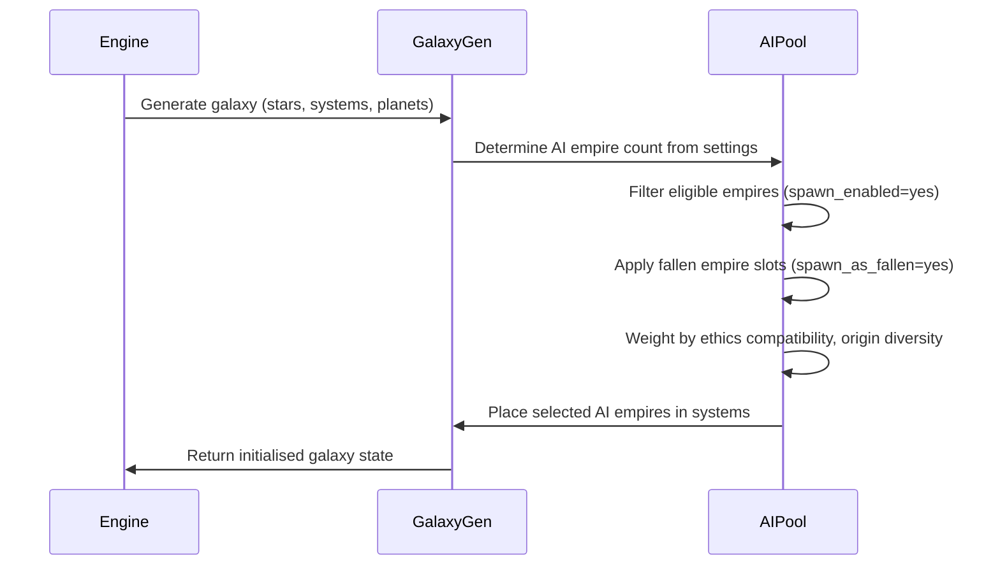

# Galaxy Generation & AI Spawning

## Trigger

Player confirms empire selection and starts a new game.

## Sequence

## AI Spawn Pool Composition

| Category | Empires | Notes |
|----------|---------|-------|
| Standard AI | 24 | All except Drengin, Protoss |
| Fallen empire candidates | 2 | Drengin Empire, Protoss Empire |
| Total mod empires | 26 | All have `spawn_enabled=yes` |

## Fallen Empire Spawning

- Galaxy settings define number of fallen empire slots (0-4 typically).
- Engine selects from all empires with `spawn_as_fallen=yes` across all loaded mods.
- Drengin and Protoss compete with base game fallen empires and other mod fallen empires.
- If selected: empire spawns with advanced start, unique fallen empire behaviour.

## Ethics & Origin Diversity

Engine attempts to create a diverse galaxy:
- Spreads ethics across AI empires (avoids all fanatic militarist, etc.).
- Spreads origins (avoids all lost_colony).
- Mod provides: 2 fanatic egalitarian, 2 fanatic militarist, 1 fanatic xenophile, 1 fanatic spiritualist, 1 fanatic materialist, 1 fanatic authoritarian, plus various standard ethics.
- Origins: 10 lost_colony, 6 default, 4 life_seeded, 3 shoulders_of_giants, 1 each for others.

## Invariants

- All 26 mod empires eligible for AI spawning.
- Fallen empire candidates only spawn if galaxy settings allow.
- No mod empire spawns without required dependencies (flags, name lists, traits).
- Galaxy generation never fails due to mod content.

## Related Documentation

- [Empire selection screen](./empire-selection-screen.md)
- [Country definitions](../components/country-definitions.md) — ethics, civics, origins table
- [Dependencies](../dependencies.md) — required assets for spawning