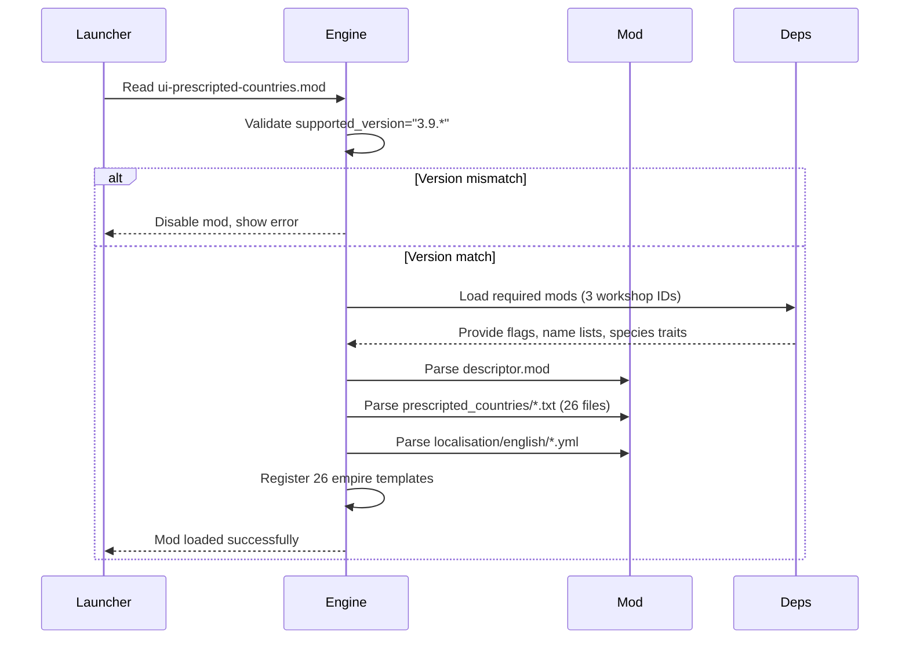

# Mod Load & Empire Registration

## Trigger

Game startup or mod reload from launcher.

## Sequence

## Steps

| Step | Actor | Action | Failure mode |
|------|-------|--------|--------------|
| 1 | Launcher | Read root `.mod` file | File missing → mod not listed |
| 2 | Engine | Validate `supported_version` | Mismatch → mod disabled |
| 3 | Engine | Load dependency mods | Missing dep → mod disabled with error |
| 4 | Engine | Parse `descriptor.mod` | Syntax error → mod disabled |
| 5 | Engine | Parse 26 country definition files | Parse error → that country skipped |
| 6 | Engine | Parse localisation YAML | Parse error → keys show as raw |
| 7 | Engine | Register empire templates | Duplicate key → second ignored |

## Data Boundaries

| Boundary | Direction | Content |
|----------|-----------|---------|
| Launcher → Engine | In | Mod descriptor, version check |
| Dependencies → Engine | In | Flag textures, name list keys, species trait keys |
| Mod → Engine | In | 26 empire templates, localisation strings |
| Engine → UI | Out | Registered empire list for selection screen |

## Invariants

- All 3 dependencies loaded before this mod.
- All 26 country files parsed (or parse error logged).
- Every non-literal key resolved to localisation string.
- No duplicate empire keys across all loaded mods.

## Related Documentation

- [Mod descriptor](../components/mod-descriptor.md)
- [Country definitions](../components/country-definitions.md)
- [Localisation](../components/localisation.md)
- [Dependencies](../dependencies.md)